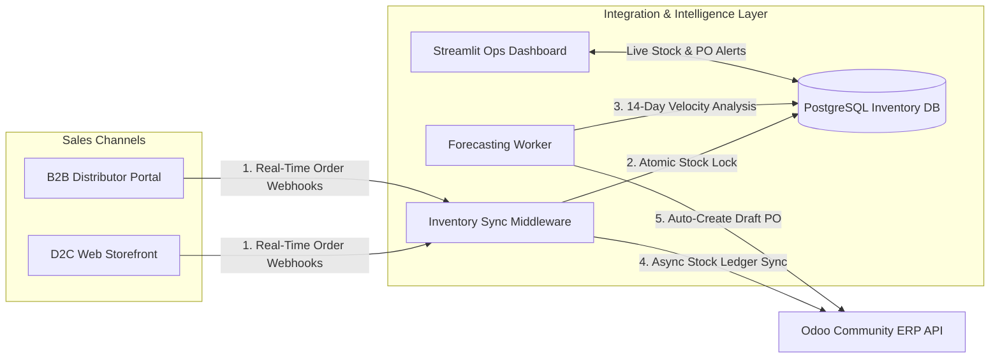

# Multi-Warehouse Inventory Sync & Automated Reorder Middleware

> **An event-driven integration middleware connecting multi-channel e-commerce storefronts with an open-source ERP (Odoo)—eliminating 24-hour CSV batch lag, preventing stockout penalties, and automating purchase order generation.**


---

## 1. Executive Summary & Business Problem

### The Business Pain Point
Mid-market and enterprise retailers selling across D2C websites, B2B distributor portals, and regional warehouses often rely on legacy ERPs synchronized once every 24 hours via fragile CSV file transfers:
1. **Overselling & Order Cancellations:** During flash sales, two channels sell the same last unit in stock, triggering refund penalties and customer churn.
2. **Trapped Working Capital:** Without real-time velocity tracking, procurement teams rely on static reorder thresholds—over-ordering slow-moving SKUs while running out of high-velocity items.
3. **Expensive ERP Rip-and-Replace:** Replacing a legacy ERP costs millions; businesses need lightweight middleware that modernizes data flow around their existing ERP.

### The Solution & Quantified Impact
This middleware sits cleanly between sales channels and **Odoo Community ERP** via REST/JSON-RPC APIs:
* **Zero Overselling Under Concurrency:** Uses PostgreSQL row-level locking (`SELECT ... FOR UPDATE`) and webhook idempotency to guarantee atomic inventory reservations across channels.
* **Automated Procurement:** Calculates dynamic reorder points from trailing 14-day sales velocity and supplier lead times, automatically pushing **Draft Purchase Orders (POs)** into Odoo ERP.
* **Non-Invasive Modernization:** Integrates via standard APIs without modifying core ERP database tables.

---

## 2. System Architecture (Legacy Batch vs. Event-Driven Middleware)



---

## 3. Tech Stack & Architectural Rationale (Why This Stack?)

| Component | Technology Choice | Architectural & Business Rationale |
| :--- | :--- | :--- |
| **Integration Middleware** | **FastAPI (Python)** | Lightweight, high-throughput REST webhook receiver with built-in Pydantic schema validation to reject malformed channel payloads early. |
| **Transactional Stock DB** | **PostgreSQL 16** | Uses pessimistic row-level locking (`SELECT FOR UPDATE`) to eliminate race conditions when simultaneous orders hit the same SKU. |
| **Enterprise ERP** | **Odoo 17 Community Edition** | Industry-standard open-source ERP (**₹0 licensing cost**) exposing full `purchase.order` and `stock.quant` APIs—mirroring SAP/NetSuite integration patterns. |
| **Forecasting Engine** | **Pandas + Scikit-Learn** | Computes dynamic safety stock using demand variance and supplier lead times rather than brittle static rules. |
| **Stakeholder UI** | **Streamlit** | Gives non-technical supply chain managers live visibility into warehouse stock health, stockout risk, and auto-generated ERP Purchase Orders. |

---

## 4. Core Business Logic & Algorithms

### 1. Atomic Multi-Warehouse Allocation
When an order webhook arrives, the middleware inspects warehouse proximity and available stock inside a single database transaction:
1. Checks `processed_webhooks` table using `order_id` + `channel_id` to guarantee idempotency.
2. Locks target SKU rows via `SELECT available_qty FROM warehouse_stock WHERE sku = :sku FOR UPDATE`.
3. Deducts stock atomically and writes an immutable `stock_movement` ledger entry.

### 2. Dynamic Safety Stock & Reorder Point ($ROP$)
Instead of static reorder thresholds, the forecasting worker calculates dynamic thresholds per SKU:
$$ROP = (\bar{D} \times L) + Z \times \sigma_D \times \sqrt{L}$$
Where $\bar{D}$ is average daily unit sales, $L$ is supplier lead time in days, $\sigma_D$ is daily demand standard deviation, and $Z = 1.65$ (95% service-level target). Whenever `available_qty <= ROP` and no open PO exists, the middleware creates a **Draft PO** directly in Odoo ERP.

---

## 5. Quickstart: 100% Free Local Setup

### Prerequisites
* Docker & Docker Compose

### Step 1: One-command deploy (recommended on Windows)
```powershell
cd multi_warehouse_inventory_erp_middleware_readme.md
.\deploy.ps1
```
Or manually:
```bash
docker compose up -d --build
```
Free cloud + demo tunnels: see [docs/DEPLOY.md](docs/DEPLOY.md).
The `odoo-init` job creates the **`inventory`** database with **stock** and **purchase** modules. The one-shot **`seed`** service loads demo warehouses/SKUs and maps Odoo products before **api** starts.

First boot can take several minutes while Odoo initializes. Watch progress with `docker compose logs -f odoo-init odoo seed`.

Endpoints after startup:
* **Inventory Middleware API (Swagger UI):** `http://localhost:8000/docs`
* **Supply Chain Ops Dashboard (Streamlit):** `http://localhost:8501`
* **Odoo 17 Community ERP:** `http://localhost:8069` (database **inventory**, login **admin** / **admin**)
* **PostgreSQL 16 (inventory):** `localhost:5433` (host port; containers use `inventory-db:5432`)

### Step 2 (optional): Re-run demo seed
```bash
docker compose run --rm seed
```

### Optional: Microsoft Authenticator (mobile QR)
The **OpenSource** ops dashboard (`http://localhost:8501`) supports optional TOTP via **Microsoft Authenticator** on another device (phone/tablet). The account appears in the app as issuer **OpenSource** with your Mudra Skyline logo on the sign-in screen.

1. Open the dashboard (Streamlit sign-in — **not** Odoo): **`opsadmin`** / **`changeme`** (override with `OPS_USERNAME` / `OPS_PASSWORD` in `.env.example`).
2. On the sign-in screen, use **Show QR code to scan on mobile**, or after login use **Security → Add Microsoft Authenticator** in the sidebar.
3. On your phone: Microsoft Authenticator → **Add account** → **Other account** → scan the QR (or enter the manual setup key).
4. Enter the 6-digit code to activate; future sign-ins require password + code from the app.

---

## 6. API Contract & Sample Payloads

### Receive Real-Time Channel Order Webhook
`POST /api/v1/webhooks/orders`
```json
{
  "event_id": "evt_d2c_99281",
  "channel": "D2C_WEB",
  "order_id": "ORD-2026-4410",
  "warehouse_code": "WH-BLR-01",
  "items": [
    { "sku": "SKU-LAPTOP-PRO14", "quantity": 3 }
  ]
}
```

### Trigger Demand Forecast & Auto-PO Sync
`POST /api/v1/procurement/evaluate`
```json
{
  "evaluated_skus": 24,
  "reorder_triggered": [
    {
      "sku": "SKU-LAPTOP-PRO14",
      "warehouse_code": "WH-BLR-01",
      "current_stock": 8,
      "calculated_rop": 15,
      "recommended_order_qty": 40,
      "odoo_po_reference": "P00042",
      "odoo_po_state": "draft"
    }
  ]
}
```

---

## 7. Presales Demo Walkthrough (2-Minute Interview Pitch)

1. **Show the "Before vs. After" Diagram:** Walk through `docs/architecture.drawio` to explain how this middleware modernizes a legacy ERP without an expensive migration.
2. **Simulate a Flash-Sale Race Condition:** Run `python scripts/simulate_concurrent_orders.py` (fires 20 simultaneous orders for 15 available units) and show that exactly 15 succeed and 5 gracefully return `OUT_OF_STOCK`—zero negative inventory.
3. **Show Live ERP Integration:** Trigger `/api/v1/procurement/evaluate`, open **Odoo ERP** (`http://localhost:8069`), and show the newly created **Draft Purchase Order (`P00042`)** waiting for procurement manager approval.